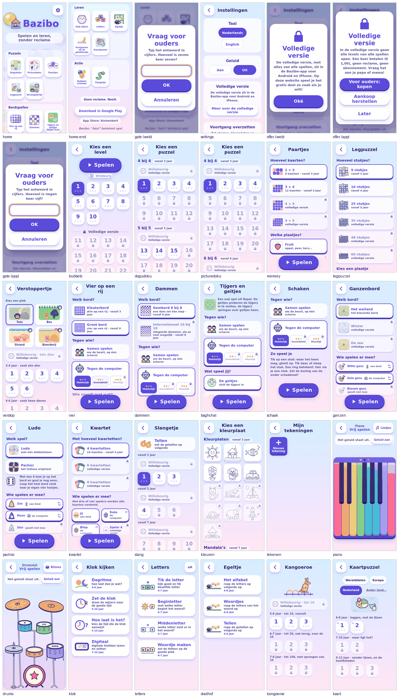

# Style audit, November 2026 (Bazibo 1.12)

Step 1 of Mark's "Bazibo 2.0" request (mail, 20 Nov 2026): what the app looks like now, measured,
with no code changed. The proposal that follows from it is [v2-proposal.md](v2-proposal.md);
the open questions for Mark are at the top of that file.

The market research summary Mark mentions was not in his mail. This audit works from the
context paragraph in the request: privacy-aware parents first, then kleuter and groep 1-4
teachers (NL and Flanders), then the open-source crowd; "no ads" alone no longer stands out;
calm, non-addictive, trustworthy and recognisably Dutch is what works.

## Top five findings

1. **Tablets in portrait cut off home tiles.** From 560 to 900 px wide the home screen is wider
   than the screen (996 px of content at 800 px) and Verstoppertje, Ludo, Kwartet and
   Kaartpuzzel (at 560 and 720 px also Drumstel) stand half or wholly past the right edge,
   reachable only by a sideways swipe. Measured at 560, 600, 720, 768, 800, 820 and 900 px;
   fine from 1024 px and on every phone. Cause: `.tile-group` gets `width: calc(var(--n) * ...)`
   at `min-width: 560px` (`web/css/style.css`, end of file) and six tiles of 124 px do not fit.
2. **Bazibo has no typeface of its own.** `--font` asks for `ui-rounded`, Nunito or Varela Round,
   none of which ships with Android or with the app. Chromium drew the brand name, the tiles and
   the section names in **DejaVu Sans** here (CDP `getPlatformFontsForNode`), and so do the store
   screenshots and the feature graphic; most Android phones get Roboto, iPhones SF Rounded. The
   letters in Letters, Egeltje and Slangetje therefore change shape per device (`a`, `g`, `I`/`l`).
3. **The look borrows from the busy side.** The mechanics are calm (no timers, never "wrong", no
   ads), but the surface speaks the grammar of free-to-play games: 207 of the 396 choices on the
   23 game menus carry a padlock or "Volledige versie" (Dogudoku 55 of 65, Picturedoku 53 of 63,
   Slangetje 29 of 39), level grids with three stars per level, glossy double shadows on every
   button, one saturated violet on every screen, and a store set whose third image is a bubble
   shooter mid-shot with a "+250" score.
4. **Accessibility is mostly good, with a handful of real misses.** Normal text passes AA nearly
   everywhere (median 5.9:1). The misses: locked text `#a59fd0` at 2.5:1; an earned star
   (`--gold`) and an empty one (`#d8d3f2`) differ by only 1.09:1 in lightness, so the difference is
   colour alone; white on the orange accent 2.35:1; the gold focus ring 1.5:1 on the light
   background. Targets: the back button shrinks to **33 px** wide next to a long title
   (Verstoppertje at 320 px; also Ganzenbord, Kaartpuzzel, Instellingen, Letters 43-47 px),
   Bubbels' "Willekeurig" button is 24 px tall, the colour swatches in Kleurplaten and Tekenen
   are 38 px at 360 px, and the home tile names are 11.5 px at 360 px.
5. **The store images do not tell the trust story.** No caption on any screenshot, nothing about
   PEGI 3, no data, open source or the one €1 purchase; the feature graphic says only "Geen
   reclame. Nooit." over bubbles. The live listing still shows 1.8.0 (short description "15
   spellen", older screenshots); the newer set in `store/` waits for 1.12.0. PEGI 3 and "Geen
   gegevens verzameld / gedeeld" do appear, but only in Play's own badges and data-safety box;
   open source appears only in the last line of the description.

## How it was measured

`tools/design_audit.py` (run with `uv run --with playwright --with pillow python
tools/design_audit.py`) serves `web/` on 127.0.0.1 and opens it in headless Chromium at 320x568
(small phone), 360x740 (phone) and 800x1280 (tablet, portrait), device pixel ratio 1, Dutch,
sound off. It captures the home screen (top and bottom), the parental gate on the website (the
Play link), settings, the offer on the website and in a stand-in app (a fake store plugin, nothing
owned), the gate in front of "Voor ouders: kopen", every game's first screen, and at 360 px a
first round where a simple heuristic reaches one (Legpuzzel stayed on its menu; Klok, Letters
and Egeltje stop at their level list). From the real DOM it records every visible touch target
that is on top (`elementFromPoint`), every visible text with its computed colour against the
most common pixel colour in a 3 px ring around it, font sizes, and how much of the screen is a
canvas. No request left 127.0.0.1. The first screens contain no canvas at all, so the DOM
numbers cover them; in-round canvases (Bubbels 84 %, Slangetje 48 %, Tekenen 43 %) are judged
from the screenshots only. Contrast "fails" on stars and locked items are reported as their own
group below, since WCAG exempts inactive controls but children still have to see them.

Contact sheets (one per size, labels under each screen):

| Small phone, 320 px | Phone, 360 px | Tablet, 800 px | First rounds, 360 px |
|---|---|---|---|
| [sheet-320.png](shots/sheet-320.png) | [sheet-360.png](shots/sheet-360.png) | [sheet-tablet.png](shots/sheet-tablet.png) | [sheet-360-play.png](shots/sheet-360-play.png) |

## Consistency across the shell and 23 games

| Aspect | Consistent | Not consistent |
|---|---|---|
| Colours | Eight shell tokens in `:root` are used everywhere (`--primary` 84 times, `--primary-dark` 81, `--gold` 80, `--ink-soft` 48) | 151 distinct hex colours across `style.css` and the 23 game stylesheets; the button-edge lilacs `#c9c1ff` and `#d6cff7` are typed out 73 times; no colour says which kind of game you are in: everything is violet |
| Type | One stack, `var(--font)`, in every stylesheet | 56 different `font-size` values; weights 800-900 nearly everywhere, so nothing stands out; Egeltje's canvas repeats the stack by hand (`doolhof/art.js`) |
| Buttons | `.btn` (pill, 6 px pressed edge, gold focus ring) and `.btn.icon` (60 px, white) are shared | 38 different `border-radius` values (3 to 32 px in 16 steps, 22 %, 24 %, 50 %, 999 px, 0.12em, ten `calc()` forms); Piano and Drums use their own pills (`.piano-pill`, `.drums-pill`, 44 px) |
| Headers | Every menu but two uses `.bar`: back left, a 25.6 px title, a slot right | Piano and Drums show a small two-line title ("Piano / Vrij spelen") with a pill; a long title squeezes the back button (finding 4) and pushes itself off centre |
| Right slot in a round | The slot is always top right | Hint bulb (Dogudoku, Picturedoku, Klok), take-back arrow (Vier, Dammen, Tijgers, Schaken, Ludo), pause (Slangetje), "aA" (Letters), nothing (Paartjes, Ganzenbord, Kleurplaten); Bubbels puts **pause on the left**, where every other game has back |
| Menus | Option cards with an icon, a title and a grey line, then a "Spelen" pill | Four patterns: a level grid (Bubbels, Dogudoku, Picturedoku, Slangetje, Verstoppertje, Kangoeroe, Kaartpuzzel, and Klok, Letters, Egeltje after a mode), a setup form (Paartjes, Legpuzzel, Vier, Dammen, Tijgers, Schaken, Ganzenbord, Ludo, Kwartet), a mode list (Klok, Letters, Egeltje), or straight into play (Piano, Drumstel, Tekenen) |
| Celebration | Every game ends on the shell's own card (`showOverlay`): title, up to three stars popping in, big buttons; `prefers-reduced-motion` stops the pop | A few add their own moment in the round (Kleurplaten, Tekenen, Verstoppertje, Slangetje, Egeltje, Drumstel); Bubbels shows score numbers ("+250") |
| Sounds | One synthesised set in `web/js/audio.js` (no files), the sound setting followed everywhere, no voice (Mark, 13 Nov) | "Well done" is `win()` in the board games, Bubbels, Paartjes, Legpuzzel and Kwartet but `chime()` in the learning games; `lose()` plays when the computer wins a board game |
| Motion | `prefers-reduced-motion` is honoured by the home background and 21 of 23 games | Not in Bubbels and Tekenen (both mostly canvas) |
| Icons | Inline SVG, one stroke style in the shell | Game art varies in line weight and shading per game (by design, each drawn on its own) |

## Accessibility

**Contrast (WCAG AA, 4.5:1 for normal text, 3:1 for large text and shapes).** 503 texts
measured at 360 px; median 5.9:1.

| Pair | Ratio | Where |
|---|---|---|
| `--ink` on the sky background | 11.1 | titles |
| `--ink-soft` on white / on lilac | 6.5 / 5.4 | option descriptions |
| white on `--primary` | 6.0 | Spelen, OK, selected chips |
| white on `--accent` / `#ff7a3d` (orange) | **2.35 / 2.6** | Drumstel's Luister, the hint counters in Dogudoku and Picturedoku, Klok's hour buttons (white + and - signs) |
| locked text `#a59fd0` / `#8a82c8` on white | **2.5 / 3.4** | every locked level number, "Volledige versie" chips |
| empty star `#d8d3f2` on white | **1.45** | under every level; and 1.09:1 against an earned star |
| focus ring `--gold` on the light background | **1.5** | keyboard focus everywhere |
| `--primary` on the "Willekeurig" pill border | 3.6 | Bubbels, 16 px normal weight |

**Touch targets (48 px asked).** Shell buttons are 56-76 px and tiles 116 px tall. Under 48:

| Target | Size | Where |
|---|---|---|
| Back button next to a long title | 33 x 60 (320 px); 43-47 elsewhere | Verstoppertje; Ganzenbord, Kaartpuzzel, Instellingen, Letters |
| "Willekeurig" (random levels) | 135 x 24 | Bubbels' level list, every phone size |
| Colour swatches (upright) | 38 x 38 at 360 | Kleurplaten, Tekenen (44 px only sideways) |
| "Geluid aan" pill | 119 x 44 | Piano, Drumstel |
| Privacy · Voorwaarden · Plannen | 18 px tall | Settings (parents only) |
| Board squares, keys | 37-44 px | Dammen, Schaken, Ganzenbord, Piano: known and handled by tap-to-nearest (AGENTS.md) |

**Text for non-readers.** The menus ask questions in words ("Welk bord?", "Tegen wie?", "Hoeveel
stukjes?") with a 15 px grey line under each option; a child who cannot read relies on the
small icon. Home tile names are 11.5 px at 360 px (`min(0.92rem, 13.4cqi)` in three columns);
ages and "Volledige versie" are 12-13 px. The page sets `user-scalable=no`, so nobody can zoom.

**Colour-blind safety.** The palettes that carry meaning, simulated for protanopia, deuteranopia
and tritanopia (Machado 2009, full severity) and compared by CIEDE2000; under about 10 two
colours start to look alike.

| Palette | Normal | Protan | Deutan | Tritan | Second cue |
|---|---|---|---|---|---|
| Dogudoku regions (8) | 10.0 | 3.3 (blue / lilac) | 1.5 (blue / lilac) | 4.7 (yellow / sand) | a pattern per region: safe |
| Picturedoku pictures (9) | 16.2 | 3.4 (banana / pear) | 2.9 (apple / mushroom) | 6.2 | shape per picture: safe |
| Bubbels (6) | 21.2 | 9.6 | 10.7 | 9.5 | a symbol per colour: safe |
| Stars earned / empty | 1.09:1 lightness | - | - | - | **none**: same ★ shape |

Dogudoku's blue and lilac regions merge for deuteranopes and only the pattern tells them apart;
the pattern is drawn at 42 % opacity, so on a phone it is faint. Picturedoku's apple and
mushroom, and banana and pear, rely on shape, which is clear. The stars are the one place where
colour is the only cue.

## Between the busy ad games and the calm premium apps

*Described from public store pages and general knowledge of the genre, not a hands-on test; no
art or layout of theirs is to be copied.*

The busy ad-funded children's games share a grammar: saturated rainbow colours, glossy and
bevelled buttons, several things moving at once, level maps with stars and padlocks, coins and
scores flying up, a sound on every tap, timers and lives, and interruptions. The calm premium
apps (Pok Pok, Sago Mini, Toca Boca) differ among themselves, but share: few elements per screen,
navigation without words, one illustrated world with its own characters, no scores or stars in
sight of the child, soft or tactile sound, a lot of space, and a parent area kept out of the way.
Pok Pok explicitly sells "gentle, non-addictive screen time".

Bazibo sits in between. **Calm already:** no ads, no timers, no lives, never "wrong", no voice,
reduced motion honoured, a parental gate, a gentle computer opponent. **Still busy:** padlocks on
more than half the choices, stars under every level, one loud violet, glossy shadows, 800-900
weight text everywhere, floating bubbles behind the home screen, menus that need reading, and a
store set that leads with a bubble shooter. **Recognisably Dutch:** the content is (Ganzenbord,
Dammen, Kwartet, Kaartpuzzel with the provinces, Klok kijken the way groep 4-5 learns it, the
number line as taught in groep 3-4), but the look says nothing about it.

## Store assets

| Asset | Tells | Misses |
|---|---|---|
| Feature graphic (`store/feature-graphic-1024x500.png`) | Brand, gazebo, "Geen reclame. Nooit." | PEGI 3, no data, open source, calm; the bubbles say "bubble shooter", a busy-game genre |
| 8 screenshots per language (`store/screenshots/`) | Real screens: home, levels, Bubbels, Dogudoku, Picturedoku, Klok, Letters, a mandala | No captions; nothing for parents or teachers; screen 3 shows a "+250" score; DejaVu Sans as the font |
| Live listing (checked 20 Nov) | Play shows PEGI 3, "Geen gegevens verzameld / gedeeld" | Still 1.8.0: "15 spellen", the older screenshots (Bubbels first on the home screen, Slangetje); open source only in the description's last line |
| App icon | Gazebo with a bubble on violet, clear at 48 px | The bubble ties the brand to the first game; violet matches nothing in the calm story |

## Quick fixes, proposed as a separate small PR

None of these change a game's rules or looks; each is a few lines of CSS. They wait for the same
approval as the proposal (issue default).

1. Home on tablets: let the sections wrap or cap `--n` so no tile passes the right edge.
2. `.bar .btn.icon { flex: none; }` and let a long title wrap, so back never drops under 56 px.
3. Bubbels' "Willekeurig" at 48 px tall; swatches at 44 px or more upright (two rows of six).
4. Empty stars as an outline (shape, not only colour); locked text `#6f6a99` (5.0:1).
5. Focus ring in ink with a paper gap; white text only on the darker accent shades.
6. Home tile names at 14 px or more at 360 px.
