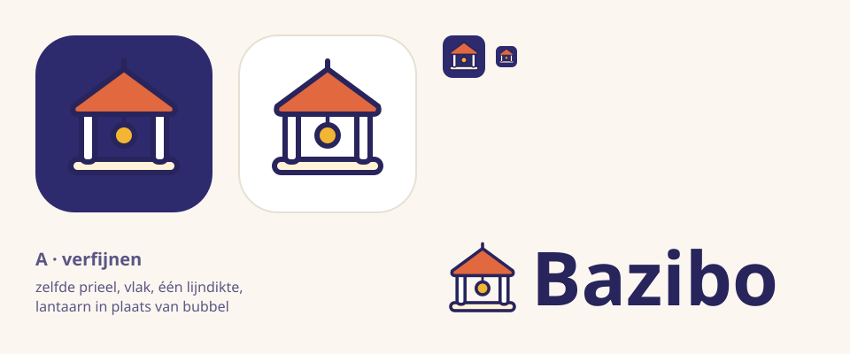
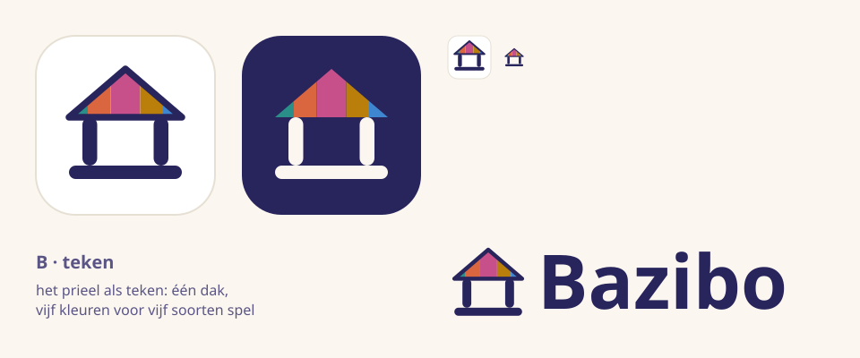
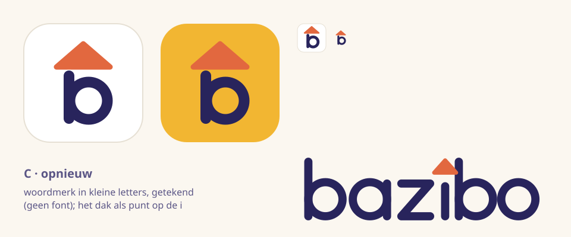
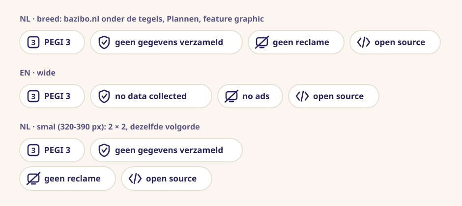
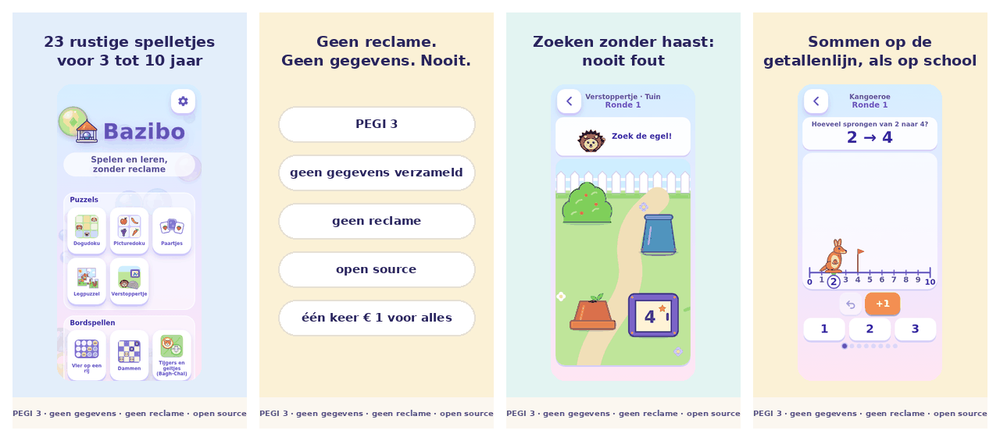

# Bazibo 2.0: design proposal

Step 2 of Mark's request (mail, 20 Nov 2026). **A proposal: nothing here is built until Mark
approves it** (waiting-on-mark issue, linked from the PR). It follows from the measurements in
[style-audit.md](style-audit.md). The market research summary was not in the mail; this works
from its context paragraph (privacy-aware parents, then kleuter and groep 1-4 teachers in NL and
Flanders, then open source; calm, non-addictive, trustworthy, recognisably Dutch).

## Open questions for Mark

Each has a recommendation; the default while unanswered is that nothing is built.

1. **Logo: A (refine), B (symbol) or C (wordmark)?** Recommendation: **B**, the roof in the five
   group colours ties the logo to the design system and reads at 24 px; A if you want the icon
   people already know from the store to stay recognisable.
2. **May the typeface be OFL?** Your mail says yes, but AGENTS.md's licence list (CC0, MIT, BSD,
   Apache-2.0, CC BY 4.0) does not name OFL; phase 1 would add "SIL OFL 1.1 for fonts" to that
   rule. Recommendation: Nunito for everything, Andika only for the letter tiles.
3. **Which letter shapes do the groep 3 reading methods use?** (`a` and `g` with one or two
   storeys.) Andika, made by SIL for beginning readers, draws them single-storey; if the methods
   use the other forms, the letter tiles keep Nunito.
4. **Padlocks out of the child's way?** Recommendation: locked choices move to one quiet
   "Volledige versie" fold at the end of each menu instead of padlocks between the free ones
   (207 of 396 choices carry one now). The free part and the offer stay exactly as they are.
5. **Stars: keep, quieten or drop?** Recommendation: keep them for the rounds (children like
   them), draw an empty star as an outline, and never show stars or scores on the home screen;
   Bubbels' "+250" points go.
6. **Tagline.** "Spelen en leren, zonder reclame" puts "no ads" first, which no longer stands
   out. Recommendation: "Rustig spelen en leren" / "Calm play and learning" in `brand.js`, with
   the trust row carrying "geen reclame".
7. **How Dutch should it look?** Recommendation: Dutch through content and tone (Ganzenbord,
   Dammen, Kwartet, de getallenlijn, provinces, "groep"-level learning) and a flat, calm
   picture-book style with clear outlines; no clichés (tulips, windmills, clogs, orange).
8. **Store captions by age or by groep?** Play has one Dutch listing for NL and Flanders, where
   "groep 3" means nothing (there it is "1e leerjaar"). Recommendation: ages ("4-7 jaar") in the
   captions; groep and leerjaar only in the description.
9. **Could you forward the market research summary?** The proposal is checked against it before
   phase 1 starts.

## Principles

- **Calm before cheerful.** Paper background, one accent per screen, fewer things moving, softer
  shadows. The games stay colourful; the frame around them goes quiet.
- **The child sees play, the parent sees the deal.** Padlocks, prices and small print move to
  the parent's places (the offer, settings, a fold at the end of a menu).
- **Every choice can be made without reading.** A picture on every option, text as a label.
- **The trust story is the same four facts everywhere**, in the same order.
- **Measured, not guessed.** Every token pair below is AA or better; `tools/design_audit.py`
  checks the result again. No tracking of any kind to "measure" the redesign: we judge it by
  playtests (Mark's children, a teacher or two) and by the audit numbers.

## 1. A small design system

Sketched as CSS custom properties in [tokens-sketch.css](tokens-sketch.css) (not loaded by the
app). Phase 1 moves them into the `:root` of `web/css/style.css`, with the old names
(`--primary`, `--ink`, `--accent`, `--gold`...) kept as aliases so no game breaks on the day.

**Colour.** Calm base: paper `#fbf7f0`, surface white, ink `#28245c` (13.1:1), ink-soft `#5a5585`
(6.4:1), a calmer brand violet `#4f43c4` (white on it 7.2:1), locked text `#6f6a99` (5.0:1, was
2.5:1), focus ring in ink with a paper gap. One accent per game group, each in three steps:

| Group | Accent (shapes, 3:1+) | Tint (backgrounds) | Ink (text on tint) |
|---|---|---|---|
| Puzzels | `#2a8f88` teal | `#e3f4f2` | `#1d6b66` (5.5:1) |
| Bordspellen | `#d9663f` terracotta | `#fbe9e1` | `#9c3f1f` (5.7:1) |
| Creatief | `#c8508a` rose | `#fae6ef` | `#8f2f5e` (6.4:1) |
| Leren | `#b97f0a` ochre | `#fbf1d6` | `#7a5600` (5.9:1) |
| Actie | `#3f86d0` blue | `#e3eefa` | `#235a96` (6.0:1) |

The group colour shows where you are: the section on the home screen, the selected option and
the win card in that game. Text never sits on an accent, only on its tint or in its ink.

**Type.** One vendored rounded family under the SIL OFL (recommended: Nunito, variable weight),
subset to Latin and Latin Extended by a tool once (like `gen-levels.mjs`; the app keeps no build
step), files and `OFL.txt` in `web/fonts/`, listed in `CREDITS.md`. Optionally Andika for the
letter tiles (question 3). Scale 1.25 on 16 px: 13, 14, 16, 20, 25, 31, 39. Nothing a child must
read under 16 px; 13-14 only for parent small print. Weight 700 for text and 800 for headings;
900 only for the brand name and the big letters. Expected size: a few tens of KB per file after
subsetting, to be measured before phase 1 (budget: 150 KB for all fonts together).

**Spacing and shape.** A 4 px grid (4, 8, 12, 16, 24, 32, 48). Five radii instead of 38: 8
(chips), 14 (cells, inputs, swatches), 22 (tiles, option cards, icon buttons), 32 (cards), pill.
One soft shadow and one 3 px pressed edge instead of the glossy double shadow.

**Components.**

| Component | Rule |
|---|---|
| Button | 56 px tall (64 for the win card), pill, brand fill or white with brand text; never white text on an accent |
| Icon button | 56 x 56, `flex: none`, so a long title can never squeeze it |
| Bar | One header for every screen: back left, title centred (wraps to two lines, never shrinks the buttons), one action right |
| Right-slot icons | Hint = bulb, take-back = curved arrow, pause = only in real-time games (Bubbels, Slangetje), always right; back is always left |
| Home tile | 128 px or more, the drawing on the group tint, the name 16 px (14 px at 320) |
| Option card | Picture, title 20 px, one line 14 px; selected = group tint with a 3 px group-accent border |
| Level cell | 64 px, number 25 px; stars as outline / filled shapes; a locked cell lives in the fold |
| Swatch | 44 px or more on every screen (two rows of six upright) |
| Win card | The shell's card, its stars in `--bz-star`, the group accent behind the art; motion off under reduced motion |
| Trust row | Four pills, see section 3 |

## 2. Logo and gazebo icon

The current gazebo works, but its bubble ties Bazibo to the first game, its gradients and
railing blur at small sizes, and it sits on the loud violet. Three directions (SVG mockups in
`docs/design/`, not in the app):

| | Direction | For | Against |
|---|---|---|---|
| A | [Refine](logo-a-refine.svg): the same gazebo, flat, one line weight, a warm lantern instead of the bubble, on calm ink or paper | Recognisable for people who know the store icon | Still a detailed drawing; says little about many games |
| B | [Symbol](logo-b-symbol.svg): the gazebo as a sign, its roof in five slices in the group colours | One roof over every game; ties into the design system; clear at 24 px | New; five colours must stay in step with the groups |
| C | [Wordmark](logo-c-wordmark.svg): lowercase "bazibo" drawn from circles and round strokes, a small roof as the dot on the i; the icon is that b under its roof | Looks identical everywhere (no font); strongest name recognition | Loses the gazebo picture; a "b" icon says less to a child |

Whichever is chosen goes into `web/js/logo.js`, and `tools/make_icons.py` renders every icon,
splash and the feature graphic from it, as now.

## 3. The trust row

**PEGI 3 · geen gegevens verzameld · geen reclame · open source**
(EN: **PEGI 3 · no data collected · no ads · open source**)

Always these four, in this order, as calm pills with a line icon ([trust-row.svg](trust-row.svg));
one row on wide screens, 2 x 2 on phones. "PEGI 3" is plain text, never the PEGI pictogram. Each
fact is a link for parents on bazibo.nl (PEGI 3 → the rating in the store, no data → the privacy
page, no ads → the promise on Plannen, open source → the repository); inside the app the row is
text only, because every link out of the app needs the parental gate.

Where: bazibo.nl under the tiles (replacing "Geen reclame. Nooit." there) and on Plannen /
Roadmap, the feature graphic, the bottom line of every store screenshot, and the first lines of
the store description. The strings go through `t()`; the brand name stays in `brand.js`.

## 4. Store screenshots for 2.0

Rendered by `tools/store_shots.py` as now (1080x1920, App Store sizes too), with a caption above
the real screen and the trust row at the bottom; paper or a group tint behind it. Mockup (Dutch,
rendered with the current font):

| # | Screen | Caption NL | Caption EN |
|---|---|---|---|
| 1 | Home | 23 rustige spelletjes voor 3 tot 10 jaar | 23 calm games for ages 3 to 10 |
| 2 | Trust (no screenshot, the four facts large) | Geen reclame. Geen gegevens. Nooit. | No ads. No data. Ever. |
| 3 | Verstoppertje, a round | Zoeken zonder haast: nooit fout | Seek at your own pace, never wrong |
| 4 | Letters, Beginletter | Eerste letters, zonder stem of tijdsdruk | First letters, no voice, no rush |
| 5 | Kangoeroe, a round | Sommen op de getallenlijn, als op school | Number-line sums, as at school |
| 6 | Dammen or Ganzenbord | Samen spelen op één scherm | Play together on one screen |
| 7 | Kaartpuzzel, Nederland | Topografie: provincies, Europa, de wereld | Map puzzles: your country, Europe, the world |
| 8 | Kleurplaten or Tekenen | Kleuren en tekenen, zonder timer | Colour and draw, no timers |
| 9 | Offer card | Eén keer € 1 voor alles. Geen abonnement. | One purchase opens everything. No subscription. |

The English set says no price (it differs per country). The feature graphic: the new logo, the
tagline and the trust row on paper; no bubbles.

## 5. What changes per game, in phases

Each phase is its own PR, ships on its own, and keeps every smoke test green; the smoke test's
size checks (44 and 48 px) move to the 48 px floor as each part is done.

**Phase 0, quick fixes** (separate small PR, see the audit's last section): tablet home tiles,
the squeezed back button, Bubbels' "Willekeurig", swatch size, outline stars, locked-text and
focus contrast, tile names. CSS only; no rules or art change.

**Phase 1, the shell.** Tokens in `style.css` (with aliases), the vendored font, the bar and
button components, the paper background (the home screen's floating bubbles go), home sections
in their group tint, settings, the offer card and the parental gate restyled, the trust row on
bazibo.nl, the chosen logo with every icon and splash, the new store set and feature graphic.

**Phase 2, the menus.** One option-card and one level-cell component for all games; locked
choices in a fold at the end (question 4); the selected state in the group colour; every option
with a picture. Order by audience: Leren first (teachers), then Puzzels, Bordspellen, Creatief,
Actie.

**Phase 3, inside a round.** The right-slot rules (Bubbels: back left, pause right), the win card
in the group accent, one "round done" sound (`chime`) and one "game won" sound (`win`) everywhere,
`prefers-reduced-motion` in Bubbels and Tekenen.

**Phase 4, art.** Per game, only where the frame clashes with the calm base; the boards and
drawings keep their own colours.

| Game | Group | Phase 2 (menu) | Phase 3-4 (round, art) |
|---|---|---|---|
| Klok kijken, Letters, Egeltje | Leren | Mode cards and level cells; locked tiers in the fold | Letter tiles in the letter font (q. 3); orange buttons get ink text |
| Kangoeroe, Kaartpuzzel | Leren | Level cells; Kaart's country pills become option cards | Kaart and Kangoeroe keep their art |
| Dogudoku, Picturedoku | Puzzels | 55 and 53 locked cells into the fold | Region pattern a little stronger (42 % → 60 %) for deuteranopes |
| Paartjes, Legpuzzel, Verstoppertje | Puzzels | Setup cards; Legpuzzel's sizes as cells | None needed |
| Vier, Dammen, Tijgers, Schaken, Ganzenbord, Ludo, Kwartet | Bordspellen | One setup-form pattern; levels as segmented cards | Take-back arrow always right; violet boards may move to the board-game tint |
| Kleurplaten, Tekenen, Piano, Drumstel | Creatief | Piano and Drumstel get the shared bar | Swatches 44 px; Piano/Drums pills 48 px |
| Bubbels, Slangetje | Actie | Level cells, quiet stars, no "+250" | Pause right, back left; Bubbels' gloss toned down |

## Hard rules that stay

No CDN, no build step, no third-party SDKs; the font vendored with its licence and in
`CREDITS.md`; every string through `t()`; the brand name only in `brand.js`; no tracking or
analytics of any kind, also not to judge the redesign; the parental gate in front of every link
out of the app.
